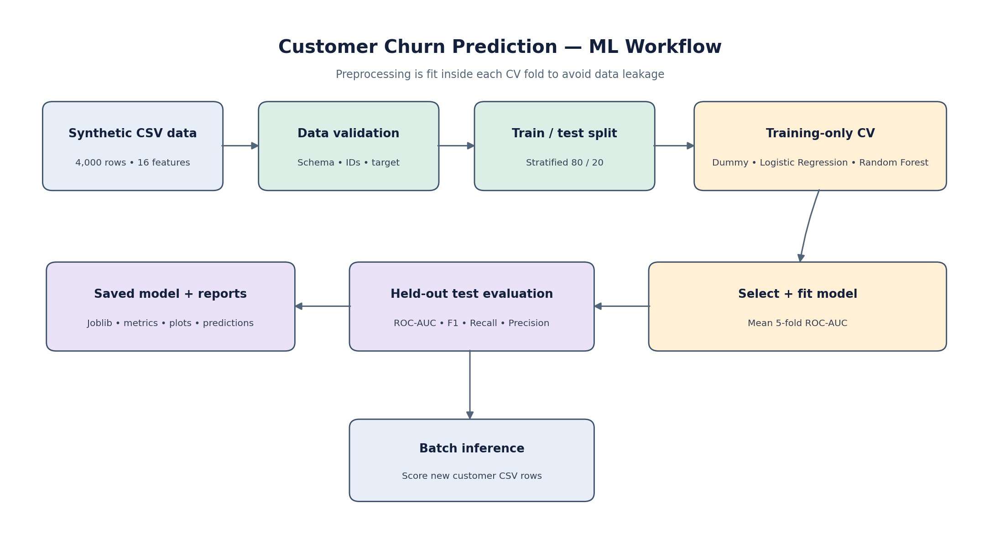

# Customer Churn Prediction — Machine Learning Portfolio Project

A reproducible end-to-end binary-classification project built with Python, pandas, NumPy, and scikit-learn. It demonstrates data validation, preprocessing, cross-validated model comparison, held-out evaluation, feature-importance analysis, and batch inference.

> **Data transparency:** The dataset is entirely synthetic and created by this repository. Model metrics are for demonstrating the workflow only; they do not describe real customer behavior or production performance.

## Project overview

- Generates 4,000 synthetic customer records and a separate sample of new customers.
- Validates required columns, unique customer IDs, and the binary target.
- Handles missing numeric and categorical values inside a scikit-learn `Pipeline`/`ColumnTransformer`.
- Uses a stratified 80/20 train/test split.
- Compares a prior-only DummyClassifier baseline with Logistic Regression and Random Forest using five-fold StratifiedKFold ROC-AUC on the training set.
- Selects the best trainable candidate by mean cross-validated ROC-AUC and evaluates it on the held-out test set.
- Reports accuracy, balanced accuracy, precision, recall, F1, ROC-AUC, and average precision.
- Saves an inference-ready model, metadata, predictions, comparison charts, a confusion matrix, ROC curve, and permutation importance.
- Includes a command-line script to score new customer rows.

## Architecture



The numeric pipeline uses median imputation and standardization. The categorical pipeline uses most-frequent imputation and one-hot encoding. Both preprocessing pipelines are fitted within each cross-validation fold, avoiding preprocessing leakage across folds.

## Repository layout

```text
customer-churn-ml-project/
├── data/
│   ├── raw/customer_churn.csv
│   └── sample/new_customers.csv
├── docs/
│   ├── architecture.mmd
│   ├── churn_pipeline_architecture.png
│   ├── model_card.md
│   └── portfolio_entry.md
├── src/churn_prediction/
│   ├── config.py
│   ├── data.py
│   └── modeling.py
├── scripts/
│   ├── generate_data.py
│   ├── train_model.py
│   └── predict_new_customers.py
├── tests/test_data_validation.py
├── artifacts/
└── reports/
```

## Requirements

- Python 3.10 or newer (use a supported Python version for the installed scikit-learn release)
- Packages listed in `requirements.txt`

Java is not required for this project.

## Run locally on Ubuntu

```bash
# From the project root
python3 -m venv .venv
source .venv/bin/activate
python -m pip install --upgrade pip
pip install -r requirements.txt

# Optional: regenerate the deterministic synthetic data
python scripts/generate_data.py

# Validate the data contract
pytest -q

# Compare models, fit the selected model, and write reports
python scripts/train_model.py

# Generate churn scores for the included sample customers
python scripts/predict_new_customers.py
```

## Main outputs

After training, check:

- `artifacts/churn_pipeline.joblib` — fitted preprocessing + model pipeline
- `artifacts/model_metadata.json` — selected model and evaluation metadata
- `reports/model_comparison.csv` and `reports/model_comparison.png` — CV comparison
- `reports/metrics.json` and `reports/training_summary.md` — test metrics summary
- `reports/classification_report.json` and `reports/confusion_matrix.png`
- `reports/roc_curve.png` — held-out ROC curve
- `reports/permutation_importance.csv` and `reports/permutation_importance.png`
- `reports/test_predictions.csv` — held-out test-set predictions
- `reports/new_customer_predictions.csv` — sample inference output

## Make predictions on a new CSV

The file must include all feature columns listed in `src/churn_prediction/config.py`. `customer_id` is optional for scoring and is not used as a model feature. Example:

```bash
python scripts/predict_new_customers.py \
  --input data/sample/new_customers.csv \
  --output reports/new_customer_predictions.csv
```

Run `python scripts/train_model.py` first so the saved pipeline exists.

## Evaluation design

Model selection uses mean five-fold ROC-AUC calculated only on the training split. The held-out test set is reserved for final evaluation. A default 0.5 probability threshold is used for predicted labels; for a real business deployment, the threshold should reflect the costs of missing a likely churner versus contacting a customer who would stay.

## Important limitations

This is a personal portfolio demonstration using simulated labels and feature distributions. It is not a production churn model and should not be used to make customer decisions. Real projects require domain-approved data, validation with representative samples, privacy controls, fairness checks, probability calibration as appropriate, and monitoring.

## License

See `LICENSE`.
